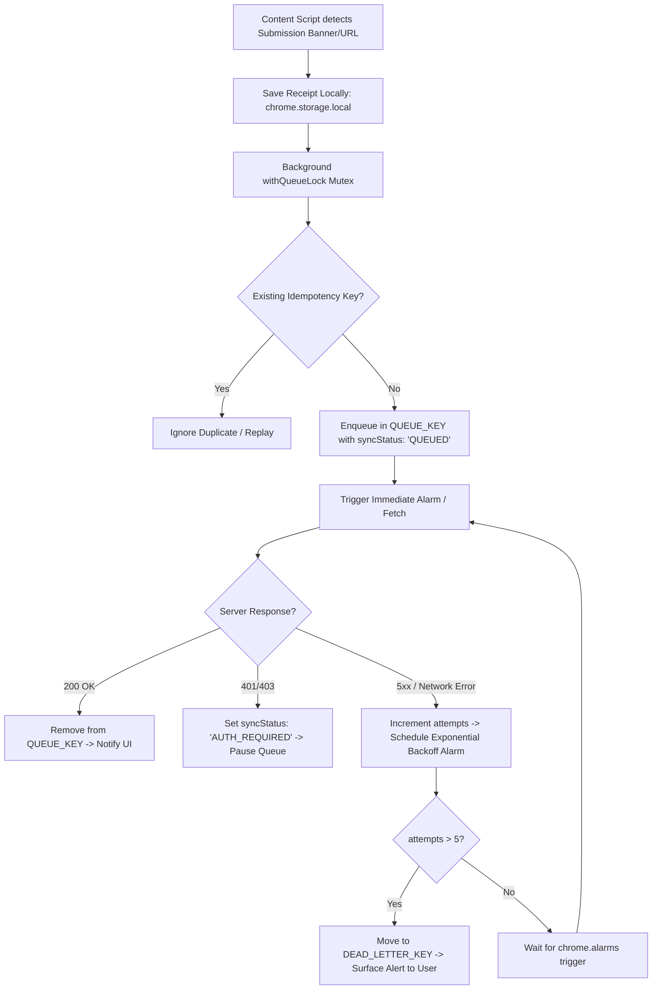

# Chrome Extension Hardening & Store Readiness Plan

> Project: **NextKinHR Recruiting Copilot (`jobright_extension/`)**  
> Architecture: **Manifest V3 (Chrome 116+)**  
> Target: **Production Resilience & Chrome Web Store Approval**

---

## 1. Executive Summary & Goals

This plan outlines concrete, production-grade architectural and implementation steps to make the **NextKinHR Recruiting Copilot** extension rock-solid across three core domains:

1. **Autofill Input Engine:** Guarantee reliable field discovery and data entry across modern reactive frameworks (React 18/19, Vue 3, Angular), custom headless comboboxes (Radix, Select2, Workday automation prompts, Kendo), and nested iframes with post-fill verification.
2. **Background Submission Queue:** Implement a crash-resilient, two-tier offline-first submission queue using `chrome.storage.local`, `chrome.alarms`, mutex locks, dead-letter queues (DLQ), and idempotent delivery.
3. **Chrome Web Store Publishing:** Ensure 100% compliance with Chrome Web Store policies, store asset requirements, exact icon dimensions, zero inline code/eval violations, and airtight permissions justifications.

---

## 2. Area 1: Autofill Input Engine Hardening

### 2.1 The Challenge: Reactive Framework Overrides & Class Drift
Modern ATS portals (Workday, Greenhouse, Ashby, Lever, SmartRecruiters) do not use simple HTML forms. They use:
* **Controlled React/Vue Inputs:** Direct mutation (`input.value = "John"`) bypasses React's synthetic event tracker. On blur or form submit, the framework resets the field to empty.
* **Custom Accessible Comboboxes (`role="combobox"`):** These render pseudo-inputs or read-only buttons that dynamically mount virtualized dropdown options into `document.body` rather than inside the form container.
* **Shadow DOM & Nested Iframes:** Embedded ATS forms (e.g. Ashby embedded on company websites) run inside sandboxed or cross-origin iframes.
* **Main Thread Freezing:** Inspecting and modifying 50+ elements simultaneously can stutter or trigger browser "Page Unresponsive" alerts.

### 2.2 Implementation Blueprint: Universal Field Writer

#### Step 1: Framework Native Property Setter Bypass
To ensure React, Angular, and Vue track programmatic values, override the property descriptor and emit the complete DOM event sequence:

```javascript
// Location: jobright_extension/core/field-writer.js

function writeInputValue(element, value) {
  if (!element || !element.isConnected) return false;

  // 1. Focus element
  element.focus();

  // 2. Select appropriate prototype descriptor
  const proto = element instanceof HTMLTextAreaElement
    ? window.HTMLTextAreaElement.prototype
    : window.HTMLInputElement.prototype;

  const descriptor = Object.getOwnPropertyDescriptor(proto, 'value');

  if (descriptor && descriptor.set) {
    descriptor.set.call(element, value);
  } else {
    element.value = value;
  }

  // 3. Dispatch full event sequence to notify virtual DOM and validators
  const eventOptions = { bubbles: true, composed: true, cancelable: true };
  
  element.dispatchEvent(new Event('focus', eventOptions));
  element.dispatchEvent(new InputEvent('beforeinput', { ...eventOptions, inputType: 'insertText', data: String(value) }));
  element.dispatchEvent(new InputEvent('input', { ...eventOptions, inputType: 'insertText', data: String(value) }));
  element.dispatchEvent(new Event('change', eventOptions));
  element.dispatchEvent(new Event('blur', eventOptions));

  return true;
}
```

#### Step 2: Resilient Combobox & Custom Dropdown Engine
For Radix UI, Headless UI, Workday prompts (`[data-automation-id*="promptOption"]`), and Select2:
1. **Trigger Phase:** Find the interactive trigger (`[role="combobox"]`, `[aria-haspopup="listbox"]`, or `.select2-selection`).
2. **Expansion Check:** Inspect `aria-expanded="true"`. If `false`, dispatch a simulated click and wait `50ms - 150ms`.
3. **Global Dropdown Search:** Query both the local container AND `document.body` for `role="listbox"`, `[data-radix-popper-content-wrapper]`, or `.dropdown-menu.show`.
4. **Fuzzy Option Match:** Normalize text content (trim, lowercase, strip punctuation) and match target option.
5. **Selection:** Click matching option, verify `aria-selected="true"` or value update, and ensure dropdown closes.

#### Step 3: Post-Fill Readback Verification
Never assume a write succeeded. Run a 50ms readback verification step:
```javascript
// Location: jobright_extension/core/field-writer.js

async function verifyWrittenField(field, expectedValue, delayMs = 50) {
  await new Promise(r => setTimeout(r, delayMs));
  
  const currentVal = readFieldValue(field.element);
  const isMatch = compareNormalized(currentVal, expectedValue);

  return {
    key: field.key,
    label: field.label,
    success: isMatch,
    actual: currentVal,
    expected: expectedValue,
    status: isMatch ? 'VERIFIED' : 'UNVERIFIED'
  };
}
```

#### Step 4: Non-Blocking Batched Execution
To prevent page jank when autofilling large forms:
```javascript
async function fillFieldsInBatches(fields, writerFn, batchSize = 5) {
  const results = [];
  for (let i = 0; i < fields.length; i += batchSize) {
    const batch = fields.slice(i, i + batchSize);
    
    await new Promise(resolve => requestAnimationFrame(async () => {
      for (const field of batch) {
        const result = await writerFn(field);
        results.push(result);
      }
      resolve();
    }));

    // Yield control back to browser rendering loop
    if (globalThis.scheduler?.yield) {
      await scheduler.yield();
    } else {
      await new Promise(r => setTimeout(r, 0));
    }
  }
  return results;
}
```

---

## 3. Area 2: Background Submission Queue Hardening

### 3.1 The Challenge: Ephemeral Lifecycles & Lost Receipts
* In Manifest V3, the service worker shuts down after **30 seconds of inactivity**.
* If a candidate clicks "Submit Application" and immediately closes the tab or navigates away, any in-flight `fetch()` in the content script or memory queue will be lost.
* Network blips or API 5xx errors can leave applications marked as "Submitted" locally but missing in the NextKinHR dashboard.

### 3.2 Implementation Blueprint: Two-Tier Offline-First Queue



#### Step 1: Deterministic Idempotency Key
Every captured receipt must generate a collision-free key derived from the candidate ID, company name, normalized job URL, and application date:
```javascript
function generateIdempotencyKey(receipt) {
  const cleanUrl = receipt.url?.split('?')[0].toLowerCase() || '';
  const dateStr = new Date(receipt.observedAt || Date.now()).toISOString().slice(0, 10);
  const rawKey = `${receipt.candidateId}|${receipt.companyName?.toLowerCase()}|${cleanUrl}|${dateStr}`;
  return hashString(rawKey);
}
```

#### Step 2: Storage Boundary Sanitization & Redaction
Never store authentication credentials or sensitive ATS tokens in the persistent queue:
```javascript
// Location: jobright_extension/background.js
function sanitizeQueueItem(item) {
  const allowedKeys = new Set([
    'eventKey', 'intentId', 'candidateId', 'companyName', 'jobTitle',
    'url', 'applicationUrl', 'confirmationUrl', 'observedAt', 'answers'
  ]);

  const body = {};
  for (const [key, val] of Object.entries(item.body || {})) {
    if (allowedKeys.has(key)) {
      body[key] = redactCredentials(val);
    }
  }

  return {
    id: item.id,
    attempts: item.attempts || 0,
    createdAt: item.createdAt || Date.now(),
    nextRetryAt: item.nextRetryAt || Date.now(),
    syncStatus: item.syncStatus || 'QUEUED',
    body
  };
}
```

#### Step 3: Alarm-Based Exponential Backoff with Jitter
Manifest V3 timers must use `chrome.alarms`. Calculate backoff with jitter to prevent server thundering herds:
```javascript
function calculateNextRetry(attempts) {
  const baseDelayMs = 2000; // 2 seconds
  const maxDelayMs = 300000; // 5 minutes
  const exponential = Math.min(maxDelayMs, baseDelayMs * Math.pow(2, attempts));
  const jitter = Math.random() * 1000;
  return Date.now() + exponential + jitter;
}

function scheduleQueueAlarm(delayMs = 0) {
  if (typeof chrome === 'undefined' || !chrome.alarms) return;
  chrome.alarms.create('process_submission_queue', {
    when: Date.now() + Math.max(500, delayMs)
  });
}
```

#### Step 4: Expand Dashboard Relay Matching
In `jobright_extension/background.js`, ensure messages relay not just to `/dashboard/*` but also to the exact root `/dashboard` route:
```javascript
// Ensure exact overview route is included
const isDashboardTab = tab.url && (
  tab.url.includes('/dashboard/') ||
  tab.url.endsWith('/dashboard') ||
  tab.url.includes('/dashboard?')
);
```

---

## 4. Area 3: Chrome Web Store Publishing Readiness

### 4.1 Manifest V3 Strict Compliance Audit

| Requirement | Audit Status in `jobright_extension/` | Action Item |
| :--- | :--- | :--- |
| `manifest_version: 3` | ✅ Present | Keep strict MV3 compliance |
| Icons exist on disk | ✅ Verified | `icon16`, `icon32`, `icon48`, `icon128` exist and are valid PNGs |
| Side panel trigger | ✅ Implemented | `setPanelBehavior({ openPanelOnActionClick: true })` present in `background.js` |
| No inline scripts / `eval` | ✅ Verified | No inline scripts in `panel.html`, no `eval()` calls in extension scripts |
| `tabs` permission declared | ✅ Declared | `tabs` permission declared in `manifest.json` |
| Host permissions separation | ✅ Separated | `host_permissions` properly separated from `permissions` |
| Packaging hygiene | ⚠️ Action Needed | Ensure `.zip` excludes `.git`, `.env`, tests, and markdown documentation |

### 4.2 Permissions Justifications for Reviewers
Every permission declared in `manifest.json` must have a specific, user-benefit justification in `CHROMEWEBSTORE.md`:
* **`sidePanel`**: Allows candidates to view their verified resume facts, job matching analysis, and autofill controls alongside the active application page without blocking form inputs.
* **`storage`**: Securely caches confirmed candidate facts and queues application submission receipts for offline resilience.
* **`tabs`**: Detects the active job posting URL to match the ATS platform and record accurate application sources.
* **`scripting`**: Dynamically automates complex multi-step forms and embedded cross-origin ATS iframes.
* **`alarms`**: Handles asynchronous background queue processing and network retries in compliance with MV3 service worker lifecycles.
* **`host_permissions` (`https://*/*`)**: Employer application portals reside on diverse custom corporate domains and subdomains (e.g. `jobs.company.com`, `careers.techcorp.io`); broad host permissions are strictly necessary to detect and fill forms on all target career sites.

### 4.3 Packaging Command
Create a sanitized production ZIP ready for upload to the Chrome Developer Dashboard:
```powershell
npm run pack:extension
```
Verify that `jobright_extension.zip` contains only runtime extension files and excludes development artifacts (`tests/`, `docs/`, `.git/`, `.env`).

---

## 5. Verification & Test Plan

Run the targeted test suites to confirm complete end-to-end resilience:

```powershell
# 1. Verify custom combobox and native setter writes
node --test tests/verified-combobox-writer.test.mjs

# 2. Verify background submission queue, locks, and DLQ transitions
node --test tests/background-queue.test.mjs

# 3. Verify submission events atomicity and idempotency
node --test tests/submission-events.test.mjs

# 4. Verify full universal form discovery and ATS mappings
node --test tests/universal-question-discovery.test.mjs
node --test tests/e2e-universal-autofill.test.mjs
```

---

## 6. Implementation Checklist & Timeline

- [x] Create and populate [CHROMEWEBSTORE.md](file:///C:/Users/bharg/Downloads/marketing-job/CHROMEWEBSTORE.md) with store listing copy, permissions justifications, and privacy disclosures.
- [ ] Audit [jobright_extension/core/field-writer.js](file:///C:/Users/bharg/Downloads/marketing-job/jobright_extension/core/field-writer.js) for native prototype setter calls on all text, number, and date inputs.
- [ ] Add post-fill readback verification logic in [jobright_extension/core/field-writer.js](file:///C:/Users/bharg/Downloads/marketing-job/jobright_extension/core/field-writer.js).
- [ ] Confirm [jobright_extension/background.js](file:///C:/Users/bharg/Downloads/marketing-job/jobright_extension/background.js) queue retries use `chrome.alarms` with exponential backoff and jitter.
- [ ] Verify message relay in [jobright_extension/background.js](file:///C:/Users/bharg/Downloads/marketing-job/jobright_extension/background.js) includes the exact `/dashboard` path.
- [ ] Capture the 4 required store screenshots (`1280x800`) demonstrating Side Panel, Autofill, and Dashboard sync.
- [ ] Execute `npm run pack:extension` and inspect the generated `jobright_extension.zip` before uploading to Chrome Developer Dashboard.
