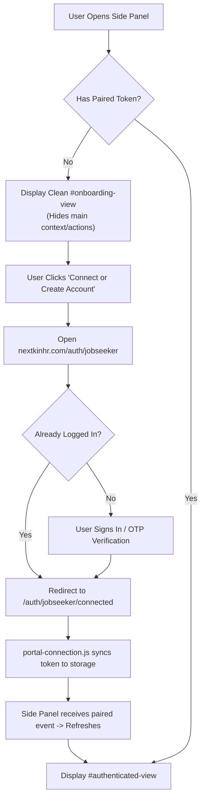

# Design Document: NextKinHR Recruiting Copilot Chrome Web Store Release & Public Onboarding

> Date: 2026-11-23  
> Status: Proposed Design (Approach 1: Cloud-First Account Pairing)  
> Target: `jobright_extension/` (v3.3.19)  
> Output Spec: `docs/superpowers/specs/2026-11-23-chrome-web-store-release-and-onboarding-design.md`

---

## 1. Intent & Why

The **NextKinHR Recruiting Copilot** is ready for release to the Google Chrome Web Store. It needs to serve two distinct user cohorts without friction:
1. **Existing NextKinHR platform candidates:** Who expect their verified resume facts, answer banks, and application tracker to sync automatically with their dashboard.
2. **Public job seekers discovering the extension in the Chrome Web Store:** Who do not yet have a NextKinHR account.

The intent of this design is to deliver an intuitive, high-converting public onboarding flow, solidify production Manifest V3 hygiene, and establish the complete release bundle required for Chrome Web Store approval.

---

## 2. Goals, Non-Goals, and Anti-Goals

### Goals
- **Welcoming Public Onboarding:** Replace technical "disconnected" states or disabled buttons in the side panel with an inviting, clear Onboarding View (`#onboarding-view`) that explains value and drives 1-click registration/sign-in.
- **Zero-Friction Pairing:** Retain automatic extension pairing via `portal-connection.js` when the candidate signs in or registers on `nextkinhr.com/auth/jobseeker`.
- **Review-Optimized Permissions:** Sanitize permissions in `manifest.json` by dropping broad wildcard `http://*/*` from both `host_permissions` and `content_scripts` in production (retaining `https://*/*` and explicit `localhost`/`127.0.0.1` origins for development) to expedite Google's security review and prevent rejections.
- **Reliable Distribution Packaging:** Ensure `scripts/pack-extension.mjs` generates a clean, valid `.zip` distribution artifact that excludes development files (`tests/`, `docs/`, `.git/`, `.env`).
- **Complete Visual Store Assets:** Produce the four required 1280×800 store screenshots demonstrating Autofill, Profile Review, Answer Bank, and Dashboard tracking.

### Non-Goals
- **Local Guest Mode (Offline Parsing):** Parsing resumes locally in browser memory or allowing unauthenticated candidates to save profiles purely in `chrome.storage.local` is out of scope for this initial store release.
- **Core Engine Modifications:** Altering ATS adapter logic, field writers, or Supabase backend APIs (which already pass all 250 unit and integration tests) is out of scope.

### Anti-Goals
- **Confusing Disconnected States:** Never show public users intimidating technical error messages (e.g. *"Candidate not found"* or *"Storage pairing failed"*) when they first open the extension.
- **Review Over-Permissioning:** Never request insecure `http://*/*` across all domains in the published web store manifest when all legitimate modern ATS platforms operate exclusively over HTTPS.

---

## 3. Approaches Considered & Trade-offs

| Approach | Description | Trade-offs | Decision |
| :--- | :--- | :--- | :--- |
| **Approach 1: Cloud-First Account Pairing** | Maintain account-linked model. Polish the unauthenticated state into an onboarding card leading to `nextkinhr.com/auth/jobseeker`. Auto-pair on sign-in. | ✅ Preserves data provenance & Supabase backup.<br/>✅ Zero backend schema changes.<br/>✅ High candidate acquisition for NextKinHR platform.<br/>⚠️ Requires sign-up before first autofill. | **Selected by User** |
| **Approach 2: Local Guest Mode** | Allow unauthenticated resume upload and local-only autofill directly in `chrome.storage.local`. | ✅ Lowest initial friction.<br/>⚠️ High engineering overhead (client-side PDF parsing).<br/>⚠️ Complex account merge and synchronization logic.<br/>⚠️ Delays release by weeks. | **Rejected** |

---

## 4. Detailed Architecture & Component Design

### 4.1 Side Panel View State Machine (`jobright_extension/panel.html`, `panel.js`)

To guarantee zero visual glitches or disabled-button confusion for public users, the side panel UI implements a clean binary top-level state toggle inside `<main>`:
* **`#onboarding-view`**: Rendered whenever `connection.token` is missing or unverified.
* **`#authenticated-view`**: Rendered when an authenticated session is paired.



#### Builder Call — UI Structure for `#onboarding-view`:
* **Container:** `<section id="onboarding-view" class="onboarding-container">`
* **Branded Hero Header:** NextKinHR logo and headline: *"Supercharge Your Job Applications"*.
* **3 Value Bullets:**
  1. ⚡ **1-Click Autofill:** Fill applications on Greenhouse, Lever, Workday, Ashby, and more.
  2. 📄 **Smart Resume Sync:** Keep your verified resume facts ready across all career sites.
  3. 🎯 **Automatic Tracking:** Sync applied jobs directly to your NextKinHR dashboard.
* **Primary Action Button:** `<button id="onboarding-connect" class="primary full-width">Connect / Create Free Account</button>`.
* **Subtext:** *"Free for candidates. Already have an account? Signing in will automatically pair your extension."*
* **Trigger:** Calls `chrome.tabs.create({ url: 'https://nextkinhr.com/auth/jobseeker' })`.

#### Builder Call — Handling Brand-New Candidates (No Resume Yet):
When a newly registered candidate returns to `#authenticated-view`:
1. If the candidate has confirmed facts, the resume details and Autofill button are enabled.
2. If the candidate is brand new and has not yet uploaded a resume to NextKinHR, `panel.js` renders the existing connected state with `#first-upload` visible:
   - Status: *"NextKinHR Connected — Welcome, [Name]!"*
   - Resume line: *"Upload a PDF or DOCX here to attach it to applications."*
   - Clear upload form: Lets them attach their resume directly within the extension or open the NextKinHR web profile editor.

### 4.2 Web Portal Auth Auto-Redirect (`src/components/jobseeker-auth-card.tsx`)

#### Builder Call — Seamless Existing Session Pairing:
In `JobseekerAuthCard`, add an initial check on mount:
```typescript
useEffect(() => {
  async function checkExisting() {
    const { data: { user } } = await supabase.auth.getUser();
    if (user) {
      router.push('/auth/jobseeker/connected');
    }
  }
  checkExisting();
}, [supabase, router]);
```
* **Effect:** If an existing candidate who is already logged into NextKinHR clicks "Connect" in the extension, the tab immediately detects their session and navigates to `/auth/jobseeker/connected`, executing `/api/extension/quick-pair` and firing `NEXTKIN_EXTENSION_PAIRED` in under a second with no redundant OTP email entry.

### 4.3 Manifest & Permissions Hardening (`jobright_extension/manifest.json`)

#### Builder Call — Safe Permission Boundary:
To pass Google Chrome Web Store automated and manual reviews without delay:
1. **Remove broad wildcard `http://*/*`** from `host_permissions` and `content_scripts[2].matches`.
2. **Explicit Development Hosts:** Allow `http://localhost/*` and `http://127.0.0.1/*` in `host_permissions` so local development and test fixtures remain functional without violating store review rules.
```json
{
  "host_permissions": [
    "https://*/*",
    "http://localhost/*",
    "http://127.0.0.1/*"
  ],
  "content_scripts": [
    {
      "matches": ["https://*/*"],
      "js": ["application-launch.js"],
      "all_frames": true,
      "run_at": "document_start"
    },
    {
      "matches": [
        "https://*.nextkinhr.com/*",
        "https://*.jobright-internal.com/*",
        "http://localhost/*",
        "http://127.0.0.1/*"
      ],
      "js": ["portal-connection.js"],
      "run_at": "document_start"
    },
    {
      "matches": [
        "https://*/*",
        "http://localhost/*",
        "http://127.0.0.1/*"
      ],
      "exclude_matches": [ ... ],
      "js": [ ... ],
      "all_frames": true,
      "match_about_blank": true,
      "run_at": "document_idle"
    }
  ]
}
```

### 4.4 Packaging Hygiene & Distribution (`scripts/pack-extension.mjs`)

#### Builder Call — Resilient Packager:
* Ensure output directory `dist/` is automatically created if missing.
* Output artifact path: `dist/jobright_extension-v3.3.19.zip`.
* Enforce strict exclusion of dev/test files (`.git/`, `.env*`, `node_modules/`, `tests/`, `docs/`, `*.md`).
* Catch filesystem write permissions issues gracefully.

### 4.5 Chrome Web Store Visual Assets (`docs/assets/`)

Assemble the 4 store screenshots at `1280×800` (PNG, 24-bit RGB):
1. **Screenshot 1 (Hero / Autofill):** Active job application (e.g. Greenhouse or Workday) with the side panel open, demonstrating autofilled form fields and high confidence score.
2. **Screenshot 2 (Profile & Facts):** Side panel view highlighting verified resume facts, contact info, and education.
3. **Screenshot 3 (Answer Bank):** Side panel showing the contextual screening answer bank (work authorization, notice period, relocation).
4. **Screenshot 4 (Application Dashboard):** NextKinHR candidate dashboard showing synced application receipts and job cards.

---

## 5. Summary of Builder Calls Made

1. **Top-Level Binary View Switch:** `#onboarding-view` cleanly replaces the `<main>` content when not connected, eliminating disabled-button clutter or confusing error notices for first-time store installers.
2. **Web Portal Auto-Pairing:** `JobseekerAuthCard` detects active user sessions on mount and auto-routes to `/auth/jobseeker/connected`, pairing existing users instantly without re-requesting an email OTP.
3. **Empty Profile Experience:** New users without a pre-uploaded resume see an inviting in-panel upload prompt (`#first-upload`) with the option to attach a PDF/DOCX immediately or edit their profile on the web.
4. **Targeted Permissions:** Replaced wildcard `http://*/*` with explicit `localhost` / `127.0.0.1` development targets, ensuring zero store review delays while keeping local development smooth.

---

## 6. Verification & Acceptance Criteria

1. **Unauthenticated Public User:**
   * Open the side panel with no session: Verify `#onboarding-view` appears with clear value propositions and the "Connect / Create Free Account" button.
   * Verify no broken error notices, disabled action buttons, or disconnected warnings are visible.
2. **Seamless Existing User Connect:**
   * Log into NextKinHR on `localhost` or production.
   * In the extension, click "Connect": Verify it navigates to `/auth/jobseeker/connected` and pairs within 1 second.
3. **First-Time Registered Candidate:**
   * Create a new account on `/auth/jobseeker`.
   * Return to side panel: Verify it reflects the candidate's name and provides the in-panel resume upload prompt.
4. **Distribution Packaging:**
   * Running `npm run pack:extension` creates `dist/jobright_extension-v3.3.19.zip` cleanly.
5. **Regression Testing:**
   * `npm test` executes and passes all 250 unit and integration tests.
